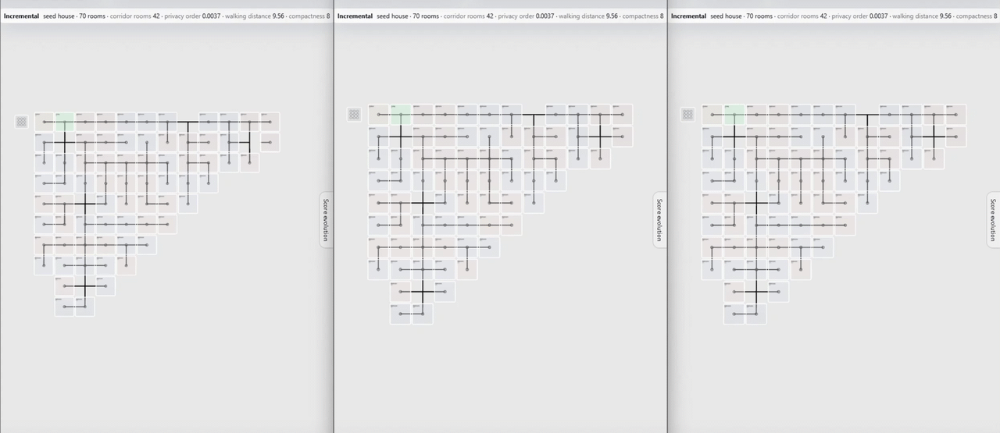
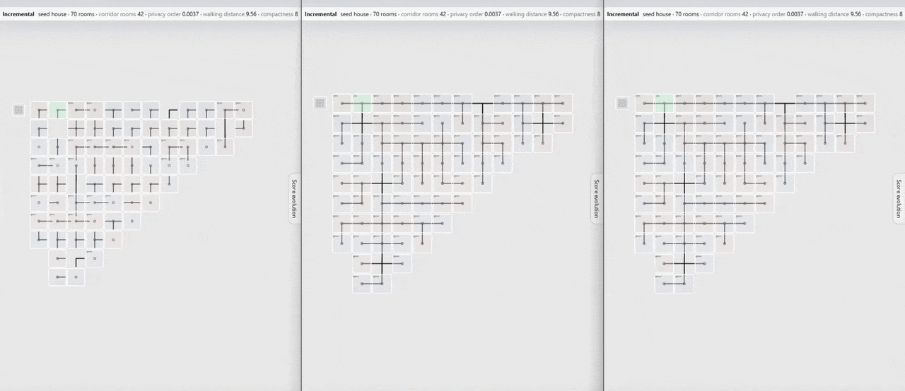
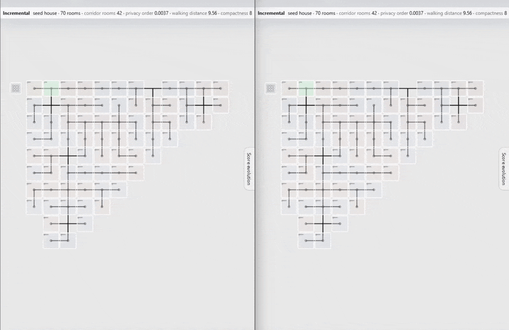

 Here we show animations of the design strategies used by the agents as they construct the 100-room house from a 70-room seed.

These are screenshots of the viewer tool, and help build a stronger intuition for the products of this research.  

Each room is a square and the lines connecting adjacent ones represent corridors through their shared doors. Lines without a square represent hallways. Yellow rooms are the ones added by the agent.

## House 1 - default / simplify + cost / cost 

Four incremental step-by-step growth trajectories of the same base house (house #1 - a difficult seed) : 
- left: agent is asked simply to add new room, without any other explicit instruction about reconstruction or cost
- center: introducing request to reduce complexity before adding, plus awareness about construction costs
- right: agent is told only about construction costs

Fun fact: Fable behaves more locally than Opus !

### Fable 5.2 medium

### Opus 5.5 medium 

### Sonnet 5.5 medium

### Deepseek 4.1 flash low 

## House 1 - simplify only, using claude and deepseek 

The incremental step-by-step growth trajectories of the same base house, when five different agents are asked to simplify it before adding a room : 

It's visible how eagerly Deepseek rebuilds, and how conservative Sonnet remains after the first rebuild. 
Opus is more balanced, it also refactors boldly but builds better designs than DeepSeek at each step. 
Fable refactors less than Opus, but more than Sonnet.
It's interesting to observe that a reorganizing Sonnet refactors as boldly as Opus on default behavior (see above).

What these animations do not show is how Deepseek models are so much slower than Claude ones, or how Pro is so much slower and error-prone than Flash.

Reading from left to right: fable 5.2 medium, opus 5.5 medium, sonnet 5.5 medium, deepseek 4.1 flash low, deepseek v4 pro low

